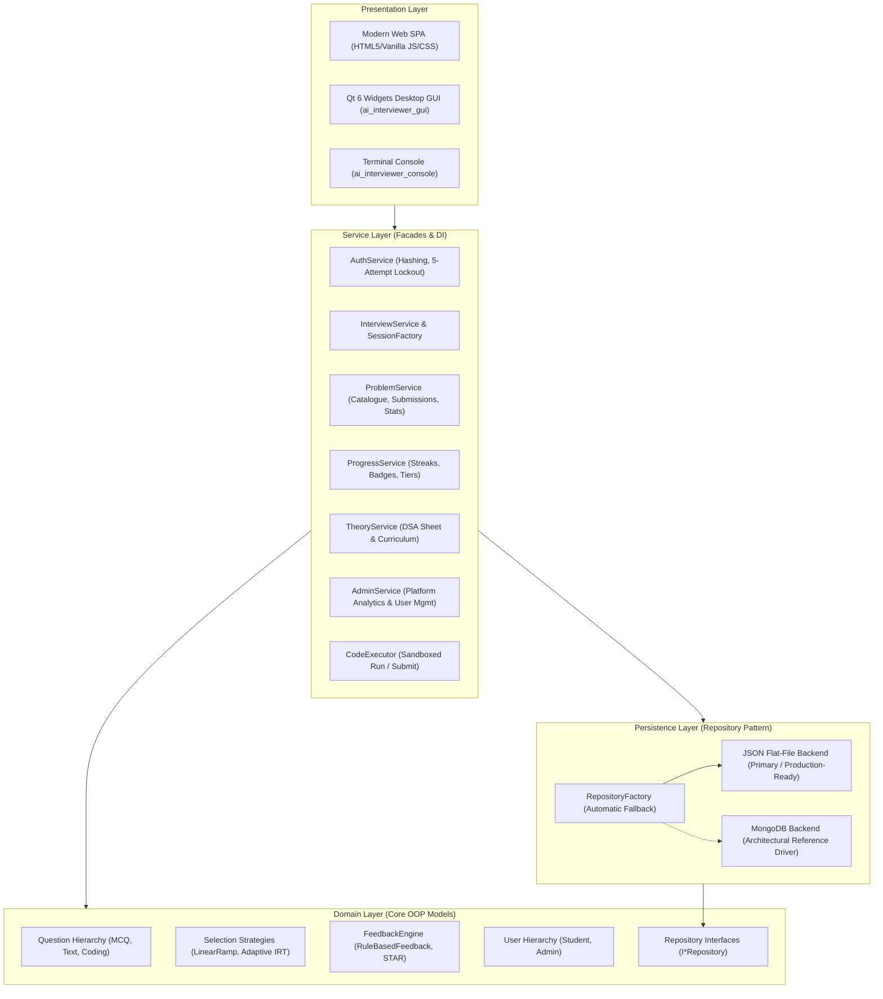

# AI Interviewer

An intelligent, multi-interface mock interview and technical assessment platform engineered in **C++17** and graded on strict **Object-Oriented Programming (OOP) principles**. The system combines an adaptive interview simulation engine, a LeetCode-style practice catalogue with sandboxed code execution, and interactive analytics across both Web and Desktop frontends.

---

## ⚡ Quick Start: Instant Live Launch

The fastest way to run and explore the application:

| Launch Option | Command / Action | Description |
| :--- | :--- | :--- |
| **Option A (Python)** | `python run.py` | Starts the local web server and automatically opens your browser |
| **Option B (Windows)** | Double-click `start.bat` | 1-click batch launcher for Windows environments |
| **Option C (NPM)** | `npm start` | Standard developer command |
| **Option D (Native C++ Web)** | `powershell scripts\run_web.ps1` | Compiles and serves the high-performance native C++ HTTP server |
| **Option E (Qt Desktop GUI)** | Run `build-gui\src\ai_interviewer_gui.exe` | Launches the native Qt 6 desktop application |

> **Offline-First Web Mode**: The web interface includes an offline adapter (`offline.js`) that operates entirely within the browser via `localStorage` and bundled question banks—delivering zero-setup immediate execution without external database dependencies.

---

## 📐 Architecture & System Design

The platform strictly adheres to **Clean Architecture** and separation of concerns. Dependencies flow strictly downwards: presentation layers contain no business logic, and services interact with data strictly through repository interfaces.



---

## 🎯 Key Capabilities & Features

### 1. Intelligent Mock Interview Engine
* **Structured 10-Question Sessions**: Balanced progression consisting of **3 Easy** (1 min, 1 pt), **4 Medium** (2 min, 2 pts), and **3 Hard** (4 min, 3 pts) questions.
* **Item Response Theory (Adaptive Strategy)**: An `AdaptiveStrategy` estimates candidate competency ($\theta$) after each answer, dynamically raising or lowering the difficulty of the next question.
* **STAR Behavioral Evaluation**: Conceptual and behavioral responses are graded across **Situation**, **Task**, **Action**, and **Result** dimensions.
* **Actionable Feedback Reports**: Automatically summarizes score breakdowns, strongest/weakest topics, time management metrics, and tailored recommendations.

### 2. Practice Catalogue & Theory Curriculum
* **310+ Curated Problems**: Covering 12 core academic and interview tracks:
  * **Core CS**: Data Structures, Algorithms, C++ OOP, Operating Systems, DBMS, Computer Networks.
  * **Engineering**: Analog Electronics, Signals & Systems.
  * **Aptitude & Soft Skills**: Quantitative Aptitude, Logical Reasoning, HR/Behavioral, Financial Accounting.
* **Curated Theory & DSA Sheets**: Interactive study sheets and reference guides built directly into the platform.
* **Rich Filtering**: Instant search, difficulty tiers (Beginner, Intermediate, Advanced), question format (MCQ, Text, Coding), and bookmarking.

### 3. Sandboxed Native Code Execution
* **Isolated Execution Engine (`execution::CodeExecutor`)**: Real C++ compilation and test execution rather than synthetic string matching.
* **Resource Safety via Windows Job Objects**:
  * Per-case timeout: **2.0 seconds** (`PerJobUserTimeLimit`).
  * Memory ceiling: **256 MB** (`ProcessMemoryLimit`).
  * Hard kill switches using `TerminateJobObject` and wall-clock safety timeouts.
* **Dual Run Modes**:
  * **Run**: Instant testing against public test cases with expected vs. actual output diffs.
  * **Submit**: Evaluates against hidden test suites, awarding verdicts (*Accepted*, *Wrong Answer*, *Compile Error*, *Runtime Error*, *TLE*, *MLE*).

### 4. Progress Tracking, Gamification & Leaderboards
* **Activity Heatmap**: GitHub-style 18-week contribution grid displaying consistent practice history.
* **Deterministic Daily Challenges**: Generates a synchronized challenge daily per course with bonus points.
* **Milestone Badges & Tiers**: Earn badges (*Problem Solver*, *Code Crusher*, *Week Warrior*) and advance through achievement tiers (*Newcomer* to *Master*).
* **Ranked Leaderboards**: Multi-dimensional filtering by scope (Global/College/Branch), time window (All-Time/Weekly/Monthly), and ranking criteria (Score/Solved/Streak) featuring a podium (🥇🥈🥉).

### 5. Administrative Dashboard
* **Platform Analytics**: Real-time user metrics, total attempts, success rates, and question bank coverage.
* **User Governance**: Administrative actions to inspect user performance, award credentials, reset streaks, or delete accounts.

---

## 🏛️ OOP Design Patterns Implemented

The project is structured to showcase textbook software design patterns:

| Pattern | Implementation in Codebase |
| :--- | :--- |
| **Polymorphism** | `Question::evaluate()` and `Question::display()` overridden across `MCQQuestion`, `TextQuestion`, and `CodingQuestion`. |
| **Strategy** | `QuestionSelectionStrategy` with interchangeable `LinearRampStrategy` and `AdaptiveStrategy`. |
| **Factory** | `SessionFactory` for interview modes; `RepositoryFactory` for backend storage selection. |
| **Builder** | `InterviewSessionBuilder` configuring multi-step interview sessions cleanly. |
| **Repository** | `IUserRepository`, `IQuestionRepository`, `IAttemptRepository`, `IScoreboardRepository`, etc. |
| **Singleton** | `Database` connection pool manager for database operations. |
| **Facade** | Service layer (`AuthService`, `InterviewService`, `CourseService`, `AdminService`, `ProblemService`). |
| **Dependency Injection** | `gui::SessionContext` injects service singletons into Qt widgets without tight coupling. |
| **Mapper** | `web::JsonApi` handles wire serialization; `db::BSONMappers` handles BSON conversion. |

---

## 💾 Storage Architecture & Backend Status

The platform supports two persistence approaches via the Repository Pattern:

### 1. JSON Flat-File Engine (Primary / Default)
* **Status**: **Fully Functional & Production-Ready**.
* Completely self-contained, auto-creating files (`users.json`, `attempts.json`, `scoreboard.json`, `daily_challenges.json`) in the `./data` directory.
* Zero configuration or database installation needed.

### 2. MongoDB Driver (Architectural Reference)
* **Status**: **Reference Implementation / Prototype**.
* Demonstrates how enterprise NoSQL databases integrate cleanly behind domain repository interfaces (`MongoUserRepository`, `MongoQuestionRepository`, etc.) with BSON serialization.
* Serves as an architectural blueprint for future scaling. The application automatically falls back to the JSON backend whenever MongoDB is offline or unconfigured (`RepositoryFactory`), ensuring uninterrupted runtime.

---

## 🛠️ Build & Installation

### Prerequisites
* **C++17 Compiler**: GCC 10+, Clang 12+, or MSVC 2019+
* **CMake**: Version 3.20+
* **Optional**: Qt 6 (for Desktop GUI), OpenSSL (for SHA-256 fallback)

### Building Native Binaries (CLI & Core)
```powershell
# Configure using CMake
cmake -B build -S .

# Build all native targets
cmake --build build --config Release
```

### Running Native Web Server
```powershell
# Runs the native C++ HTTP REST API on port 8080
powershell -ExecutionPolicy Bypass -File scripts\run_web.ps1
```

### Running Qt 6 Desktop GUI
```powershell
# Build and run the desktop application
cmake --preset gui
cmake --build --preset build-gui
build-gui\src\ai_interviewer_gui.exe
```

### Running Automated Test Suite
```powershell
# Google Test suite
ctest --test-dir build --output-on-failure
```

---

## 📂 Repository Directory Structure

```
AI-Interviewer/
├── include/                # Modular C++ header interfaces (one class per file)
│   ├── core/               # Domain entities, value objects, and repository interfaces
│   ├── auth/               # Authentication and password security
│   ├── interview/          # Interview orchestration, Builder, and Strategies
│   ├── problem/            # Problem catalogue and submission evaluation
│   ├── progress/           # Streaks, badges, leaderboards, and user stats
│   ├── execution/          # Sandboxed CodeExecutor (Windows Job Objects)
│   ├── db/                 # JSON and MongoDB repository declarations
│   ├── web/                # HTTP server, REST endpoints, and JsonApi mappers
│   └── gui/                # Qt 6 widget and screen declarations
├── src/                    # C++ source implementations matching include/
│   ├── core/               # Domain evaluations, IRT strategies, and STAR feedback
│   ├── db/                 # Repository storage implementations
│   ├── execution/          # Subprocess compiler and sandbox execution logic
│   ├── gui/                # Qt 6 screen implementations and custom painters
│   ├── web/                # Native HTTP server implementation (cpp-httplib)
│   └── main.cpp            # Terminal CLI entrypoint
├── web/                    # Modern Obsidian & Zinc Web Application
│   ├── index.html          # Semantic HTML5 layout
│   ├── app.js              # Client-side router, view renderers & state management
│   ├── offline.js          # In-browser offline API adapter (localStorage)
│   ├── style.css           # High-contrast, WCAG 2.1 AA compliant styling
│   └── data/               # Bundled questions and theory reference files
├── data/                   # Authoritative question banks and theory modules
│   ├── questions/          # Subject-specific JSON banks (310+ questions)
│   └── theory/             # DSA curriculum and subject theory articles
├── tests/                  # Google Test (GTest) and QtTest verification suites
├── scripts/                # Utility scripts for data preparation and testing
├── run.py / start.bat      # 1-click zero-dependency live browser launchers
└── CMakeLists.txt          # Multi-target CMake build configuration
```

---

## 📜 License

This project is licensed under the MIT License.
